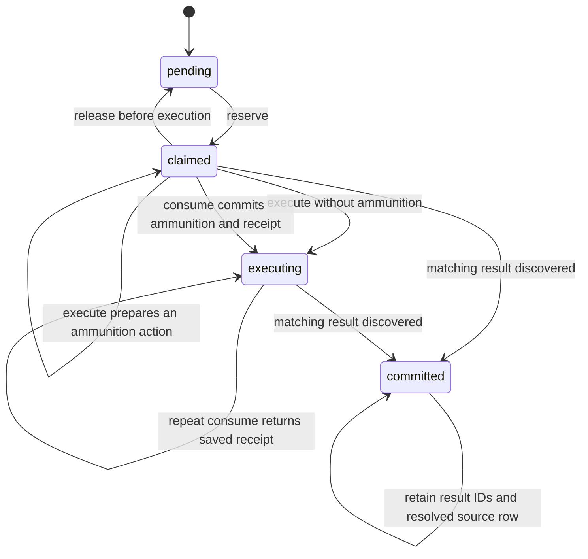
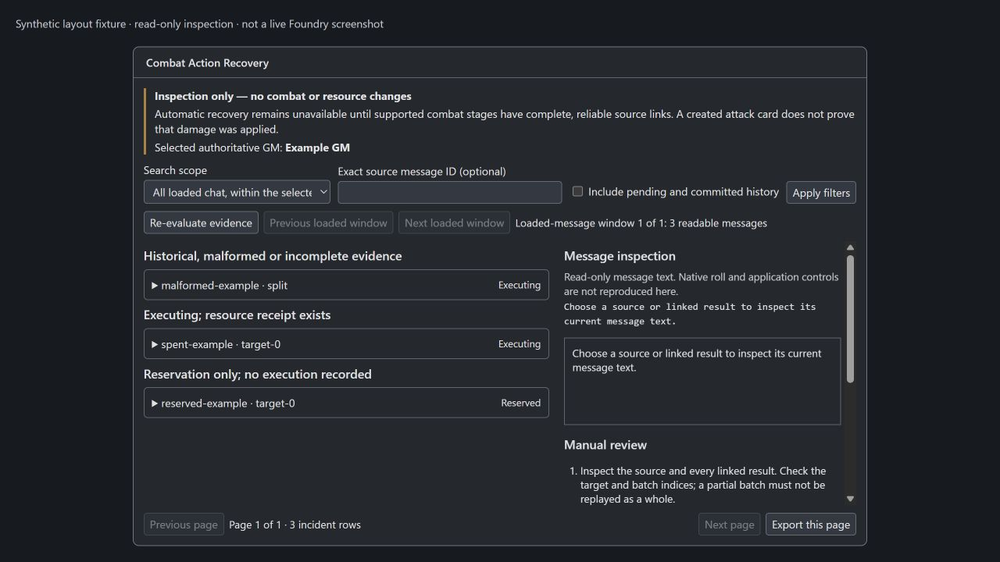
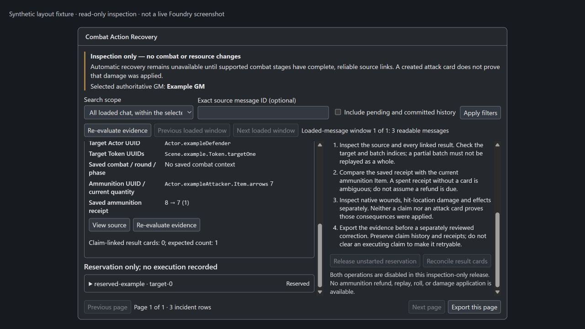

# Combat action recovery: B02 inspection release

Implemented on 2026-11-03 against the existing Skjaldborg action-claim protocol
and the installed Age of Vikings 14.7 source. Target runtime acceptance remains
Foundry VTT 14.369+ with AoV 14.7.

## Delivery and prerequisite

This release provides a GM-only, read-only incident console. Enable **Debug
logging** in Skjaldborg settings first; only then is **Combat Action Recovery →
Inspect combat actions** registered in the settings menu. Turning debugging off
removes the entry and closes an open console. Reopen Configure Settings after
saving the toggle to see the updated menu. Direct opening through
`game.aovSkjaldborg.diagnostics.recovery.open()` also requires debugging. The
ApplicationV2 permission gate protects direct use as well.

The attached B02 plan explicitly requires: “If B01 is not complete, deliver
read-only inspection with disabled exact-reconcile operation and clearly
document the prerequisite.” That gate applies. See
[the B01 implementation report](combat-result-provenance.md): attack creation
has exact module provenance, but the installed native AoV damage pipeline does
not expose a supported creation-time parent association for all downstream
stages. A created attack card does not establish applied damage or effects.

**Release reservation and reconcile are disabled.** Neither action has a bound
handler. The console does not call `updateChatActionClaim`, send a socket
request, update a document, refund ammunition, roll, replay a batch, or apply
damage. No repair was executed during implementation. Existing combat controls
and the existing protocol continue to work as before.

## Existing protocol and durable evidence

The claim owner remains `combat/dialog-target-queue.mjs`. Its source Message
stores versioned `actionClaims`, a combat context and per-slot entries. Slots
are `target-N` or `split`; claim identity is source Message UUID plus slot and
attempt ID. The source `targetQueue`/`splitAttack` row stores the Actor, owned
weapon and targets. Result Messages can carry `actionClaim`, additive
`combatProvenance` and `combatCardBatch` evidence. A saved ammunition receipt
contains before/after/count; current Item quantity is a separate observation.

The existing transitions are:

These arrows describe the existing controller, not operations offered by the
console. A live reservation can be rejected by the existing lease checks;
reservation age is diagnostic only here. An executing claim has no automatic
release or timeout recovery. Ammunition actions stay `claimed` after execution
preparation until the existing batched consumption persists `executing` and
its receipt. A rejected consumption batch does not authorize native card
creation. Native card creation and the later source update can still be
interrupted separately.

The existing controller can mark a split claim committed after finding some
matching result receipts. The audit therefore checks admitted target count,
batch indices, batch size and batch identity independently of that state flag;
a partial split remains visible in the default incident list even if the
source says committed. No controller transition was changed for this feature.
The narrow controller edit shares claim-key and proof-reading helpers with the
audit, preserving its existing scan and write queue.

## State and evidence matrix

| Evidence | Console classification | Available behavior |
| --- | --- | --- |
| `claimed`, no receipt or matching result | Reservation only | Inspect; age does not authorize release |
| `executing`, no resource receipt or result | Executing, no receipt | Inspect; absence is inconclusive |
| `executing`, consistent before/after/count receipt, no result | Executing, receipt exists | Inspect saved receipt and current Item separately |
| Matching claim result, source not fully updated | Result cards linked | Inspect linked card; downstream completion remains unverified |
| Some admitted split results exist | Partial split | Inspect each surviving index; never replay whole batch |
| `committed`, resolved source and complete claim result set | Already committed | Optional history; no second action |
| `pending` with no contradictory evidence | Pending history | Optional history |
| Unknown version, invalid row/state, contradictory receipt, wrong result or batch identity | Malformed or incomplete evidence | Inspect and preserve; no conversion or deletion |
| Result survives deleted source | Missing source evidence | Show surviving receipt without inventing authoritative source state |

Missing Actors, owned weapons, target Tokens, ammunition, changed combat context
and incomplete attack provenance are reported as explicit reasons. A missing
ammunition Item does not erase its saved receipt. A recorded result which is
missing or unreadable is shown as unavailable. Wrong card indices fail attack
creation-proof validation. Claim linkage and attack-card proof are displayed
separately; neither proves native damage application.

## Permissions and UI lifecycle

The settings menu is restricted to GMs; render, inspection, navigation and
export also check the current GM role. Message flags and rendered content are
read only when both documented `ChatMessage.visible` and `isContentVisible`
are true. A guessed source ID does not bypass these checks. The console shows
`canUserModify(user, "update")` as evidence, never as authority to repair.
Current ammunition quantity additionally requires Item observer permission.

Both the selected GM and other GMs receive read-only behavior. Selection uses
the module's existing `firstActiveGm` helper. Connection/role changes close the
console and clear its DOM. Async message previews recheck current visibility,
document identity, selected GM, selection and evidence revision before putting
text on screen. Message visibility changes immediately remove incident text
and preview content before a coordinated refresh.

This is one `HandlebarsApplicationMixin(ApplicationV2)` form with explicit
submit handling and declared actions. Preview text comes from documented
`ChatMessage.renderHTML`; it is inserted as text, without interactive native
card controls. Filters and preview selection are navigation preferences only.
Claims, receipts and quantities are always freshly read from documents.

Hooks register once through the existing feature registry. While the console
is open, relevant Message, Combat, Item and Token changes invalidate its
RenderCoordinator surface; authority changes close it. Closing the app clears
selection and invalidates delayed previews. There are no timers, recurring
history polls, per-chat-render scans, global window handlers or persisted UI
records.

## Search and export bounds

Each refresh examines one window of at most 1,000 **loaded** Messages, with
explicit previous/next window controls. It retains up to 500 incident rows,
examines up to 32 slots per source and 32 results per incident, and renders 25
rows per page. An exact source ID can focus a source outside that window;
recorded result IDs are looked up directly. A result that was created before
source commit failed might have no saved result ID and lie in another window.
Use the window controls to inspect it. Missing results are never proof that an
action did not happen. This feature does not load or search server-side history.

Export rebuilds evidence for the current page and saves an allowlisted JSON
summary, bounded to 1 MiB. It excludes message HTML, roll payloads, names,
arbitrary flag objects, Actor system data and hidden Message contents. It does
include readable source/result UUIDs, claim identity, target UUIDs, resource
receipt, observed quantity, evidence reasons and scope/time. It is a local
download through Foundry's documented file-save utility.

## Validation and remaining acceptance

The existing contract runner was extended because B02 explicitly requires
these checks. Disposable fixtures cover every class above, corrupt and unknown
claims, contradictory receipts, wrong source-card index, partial committed
batches, deleted source/ammunition, hidden Message flag access, hidden result
content, unauthorized players, secondary GMs, export allowlisting, 5,000 history
Messages with 50 simultaneous incident rows, 25-row pagination, repeated hook
registration and delayed preview completion after a GM connection change.
Debug gating checks cover hidden-by-default menu registration, repeated
enabling, removal on disable, clearing/closing an open console and direct-open
rejection while debugging is disabled.
Refresh, export and handover produce zero document writes. Existing claim,
provenance, socket, combat and action-UI contracts remain in the same run.
The existing claim fixtures also exercise cancellation, interrupted creation,
failed source commits, duplicate outcomes and rejected batched resource writes.
These simulate durable states; they do not establish real browser/server timing.

The screenshots below use the actual template, prepared context and compiled
module CSS with synthetic documents and a simulated application frame. They
verify layout, separate scroll regions and disabled controls. **They are not
screenshots of a live Foundry world or certification of native application
styling, sockets, permissions or multi-client behavior.**

Live acceptance remains pending: Foundry 14.369+ with AoV 14.7, GM and player
clients, blind/whisper combinations, disconnect/reconnect, reload, two GMs,
real native card creation, source-update failures and document deletions while
open. One-click release/reconciliation also requires completion and validation
of the supported B01 provenance path first. No automatic repair acceptance is
claimed. Existing manifest verification metadata was not raised.

Final local checks:

| Check | Result |
| --- | --- |
| Syntax | 124 module files parsed |
| Runtime imports | 123 modules reachable from the entry point |
| Templates/localization | 947 English leaf keys checked |
| Styles | Compiled release CSS matches SCSS, 141,230 bytes |
| Installed AoV contract | 14.7, all 8 expected integration paths present |
| Contract runner | Existing suites and added recovery fixtures pass |
| Packaging | Existing folder builder produced `dist/aov-skjaldborg` |

The implementation uses the official v14 documentation for
[ApplicationV2](https://foundryvtt.com/api/v14/classes/foundry.applications.api.ApplicationV2.html),
[HandlebarsApplicationMixin](https://foundryvtt.com/api/v14/functions/foundry.applications.api.HandlebarsApplicationMixin.html),
[ChatMessage permissions and rendering](https://foundryvtt.com/api/v14/classes/foundry.documents.ChatMessage.html),
[userConnected](https://foundryvtt.com/api/v14/functions/hookEvents.userConnected.html)
and [saveDataToFile](https://foundryvtt.com/api/v14/functions/foundry.utils.saveDataToFile.html).

The installed AoV system and live module directory were not overwritten.
The validated runtime folder is `dist/aov-skjaldborg`; no release ZIP was
replaced. Installed native source hashes were rechecked unchanged:

| AoV file | SHA-256 |
| --- | --- |
| `system/apps/checks.mjs` | `94E3002ADCC4067A68E8F44AF03AAA78A6031D70F61DD09C6FDBE7A2B43E386C` |
| `system/chat/combat-chat.mjs` | `7A4701CCFB07333BE3A39519822A74EDC8F249C339DAC493D58EC90A128537AF` |

## Rollback

The pre-B02 originals and their hashes are saved at
`C:\Temp\skjaldborg-recovery-20261103-103910`. Restore these seven files
together from their matching relative paths:

- `scripts/main.mjs`
- `scripts/settings.mjs`
- `scripts/combat/dialog-target-queue.mjs`
- `lang/en.json`
- `src/styles/skjaldborg.scss`
- `styles/skjaldborg.css`
- `tools/module-tool.mjs`

Then remove the newly added app, audit and evidence helper modules,
`templates/combat-action-recovery.hbs` and
`src/styles/apps/_combat-action-recovery.scss`; rebuild the runtime folder from
the restored source. This report and screenshots may remain as history.
The originals already contain the earlier B01 changes, so this rolls back B02
without undoing B01. No world data migration or record cleanup is necessary.
Do not remove claim history, native Messages, ammunition receipts or effects.
