# B01 combat result provenance: implementation and acceptance report

Date: 2026-11-03. Target: Foundry v14.369+ / AoV 14.7.

**PARTIAL DELIVERY.** Attack creation and adapter-owned defense commits now save
exact source/card proof. Existing returned-ID prone damage carries a validated
result-side receipt. Native AoV damage still lacks creation-time parent proof;
that branch stops at the plan's integration gate. This is not end-to-end runtime
certification, a new combat rule, or a completed interrupted-action recovery UI.

## Verified source and API boundaries

The initial neighboring checkout `C:/dev/aov/aov-system` is AoV 14.5. The user
then supplied the installed system at
`C:/Users/Varys/AppData/Local/FoundryVTT/Data/systems/aov`; its manifest is **14.7**.
The installed source was read without modifying it. Its relevant hashes are:

| AoV 14.7 file | SHA-256 |
| --- | --- |
| `system/apps/checks.mjs` | `94E3002ADCC4067A68E8F44AF03AAA78A6031D70F61DD09C6FDBE7A2B43E386C` |
| `system/chat/combat-chat.mjs` | `7A4701CCFB07333BE3A39519822A74EDC8F249C339DAC493D58EC90A128537AF` |

Confirmed in that source:

- `COCard.CODamage` reads the exact source message/card to prepare a damage
  request, but does not pass either identity into the request. Its local
  `newMsg` result is not returned to a caller.
- `AOVCheck.startCheck` constructs the native card with a fixed field list;
  `showChat` constructs another fixed flag list. Neither accepts a module
  provenance flag through the existing request contract.
- `startCheck` returns the newly created message ID; Skjaldborg's existing
  prone override already consumes that return. Its receipt is saved **after**
  creation. This is an exact returned-ID association, not creation-time proof.
- `COHitLoc` edits damage card index 0 in place. `COApplyDmg` delegates to
  `AOVDamage.addWound`; the latter returns a boolean, creates a Wound or updates
  NPC damage without a source-message receipt, and caps limb damage. A DM card
  or source attack does not prove that HP changed.
- No dedicated source/result combat hooks were found in the installed system.
  No new system/private method calls, wrappers or monkey patches were added.

Foundry API authority used:

- [ChatMessage create, flags and update](https://foundryvtt.com/api/v14/classes/foundry.documents.ChatMessage.html).
- [DatabaseCreateOperation.keepId](https://foundryvtt.com/api/v14/interfaces/foundry.abstract.types.DatabaseCreateOperation.html):
  the adapter allocates a normal random document ID and retains it in the same
  create operation, allowing its own UUID to be recorded before persistence.
- [fromUuidSync](https://foundryvtt.com/api/v14/functions/foundry.utils.fromUuidSync.html):
  exact Token document lookup; no substitution of an active/controlled Token.
- [Hook events](https://foundryvtt.com/api/v14/modules/hookEvents.html): existing
  create/update observers are retained; no new render hook was introduced.
- [modifyBatch](https://foundryvtt.com/api/v14/functions/foundry.documents.modifyBatch.html):
  existing claim/resource batches are unchanged. No atomicity across native
  prompts, rolls, message creation, HP application and effects is claimed.

The official reference currently labels itself 14.368 Stable. No 14.369-only
behavior, unsupported lifecycle, or higher verified manifest version is inferred.

## Event graph and ownership

```mermaid
flowchart LR
  A[Skjaldborg AppV2 form] --> B[Existing socket and action claim when applicable]
  B --> C[Adapter creates CO message: attack card 0 + source proof]
  C --> D[Exact defender prompt: message ID + source card 0 + Token UUID]
  D --> E[Existing GM document queue: defense card 1 + proof in one update]
  E --> F[Native AoV opposed resolution edits the same cards]
  F --> G[Native damage button]
  G --> H[Native DM message: parent identity unavailable]
  F --> I[Existing prone override returns exact DM message ID]
  I --> J[Save result receipt before refreshing source marker]
  J --> K[Validate parent, source card, result card and Token identities]
  H --> L[Unresolved source: preserve native manual workflow]
  K --> M[Existing hit location and pending applied-Item tracking]
  M --> N[Effects retain DM message/card plus known attack identity]
```

| Scenario | Source/result identity and owner | Delivery boundary |
| --- | --- | --- |
| Single melee/parry | Adapter CO card 0; defense appended as card 1 to that exact message | Creation proof and target validation implemented; subsequent native DM gated |
| Missile | Same adapter attack/defense path; missile source flag remains on the attack | Exact links take precedence; raw native DM is never assigned to a recent shot |
| Multiple targets | Current adapter creates a separate CO message per target, with batch ID/index/size | Each message has its own card-0 proof; no new claim or shared result slot |
| Split attack | Existing prompt claim/key/attempt and result IDs remain authoritative | Follow-up root proof is saved with its existing claim; source refresh failure does not erase creation proof |
| Fumble | Native AoV creates a separate fumble message | No supported creation-time metadata boundary; no invented source flag |
| Dodge / no defense | Adapter creates defense card 1 on the exact CO message | Same target/index validation and commit proof as parry |
| Projectile shield cover | Existing missile consumer reads the linked DM and its card index | Unlinked results are withheld from automatic shield attribution; existing damage arithmetic is unchanged |
| Impaling weapon | Damage tracker consumes exact source or explicitly legacy metadata, then waits for an applied Item | New unresolved sources cannot select a neighboring attack or infer the submitted CT selection |
| Aimed strike / disarm | Source selections remain on attack card 0; damage consumers share the resolver | Unlinked native DM cannot apply a neighboring selection; manual native resolution remains available |
| Core Actor-sheet attack | Native AoV retains its own workflow | No Skjaldborg origin is manufactured, even beside an eligible old attack |
| Knockback / grapple / stun reaction and summary cards | Specialized owners and existing flags remain in place | Their complete result/effect graphs are outside this partial slice; no end-to-end proof claim |

## Flag contract

Existing fields are preserved. The additive flag is
`flags.aov-skjaldborg.combatProvenance`, version **1**. A separate record is
needed because existing `combatCardBatch`, per-feature flags and `actionClaim`
do not represent per-card source/result identities or resolution states.

| Field | Meaning |
| --- | --- |
| `version` | Strict version gate; unsupported versions fail closed |
| `cards[<result index>]` | Bounded card map; supported indices are 0 through 31 |
| `resolution` | Persisted proven records use `exact`; the reader returns `exact`, `missing`, `ambiguous` or `legacy` with a reason |
| `stage` | `attack`, `defense` or `damage` on the implemented paths |
| `sourceMessageUuid`, `sourceCardIndex` | Exact root message and card; root attack references itself at index 0 |
| Attacker/target Actor and Token UUIDs | Independent primitive identities; synthetic Token Actors stay distinct |
| `weaponUuid`, `damageType` | Submitted source identity and existing damage-type selection |
| `combatUuid`, `logicalRound`, `phase` | Creation context; no inference from the currently selected combat |
| `actionKey`, `attemptId` | Copied only from a real existing v1 action claim; ordinary attacks receive no claim |

The containing document UUID and map key identify the result; no duplicate
result-ID list or nested graph is stored. Result copies use a fixed field list.
Existing native flags, message content, rolls, recipients, blind state and
delivery options retain their owners. The attack's existing public creation
policy is unchanged. No mass migration or historical render-time writes run.

Damage effects and selected hit-location metadata additionally record source
card index/resolution and damage message/card identity using their existing
flag families. An exact source association is never described as proof of HP
application. Injury's existing `sourceMessageId` meaning (the DM message) is
preserved; separate attack identity fields avoid repurposing it.

## Edit surface and compatibility policy

| File | Responsibility |
| --- | --- |
| `scripts/combat/result-provenance.mjs` | Shared bounded contract and read-only resolution; no hook, manager, transaction service or world migration |
| `scripts/adapter/aov-adapter.mjs` | Attack proof in creation; exact defense ID/index and Token validation; defense proof saved in the same update as its native card |
| `scripts/socket/sanitizers.mjs` | Preserve a supplied defense source index; malformed values become invalid, never silently index 0 |
| `scripts/combat/prone-damage-automation.mjs` | Restrict source selection to card 0; save returned-ID receipt before source refresh; reject invalid proof before location automation |
| `scripts/combat/{missile,aimed-blow,disarm}-automation.mjs` | Shared exact-first source lookup; selected-GM observers; existing arithmetic and manual buttons retained |
| `scripts/combat/damage-effect-tracking.mjs` | Shared lookup, explicit unresolved tracking, synthetic Actor UUID checks, no FIFO tie-break for indistinguishable applied Items, source/card metadata on effects |
| `scripts/diagnostics.mjs` | Report the partial boundary in existing diagnostics |
| `tools/module-tool.mjs` | Focused fixtures in the existing runner; repair the pre-existing missing DOM fixture method |

An explicit missing, unsupported, deleted or conflicting proof never falls
through to recent-message matching. The result-side proof remains usable when
only a source's completion marker failed; if the source itself was deleted,
the association is unresolved and is never reassigned.

The 10-minute fallback is retained **only for results already carrying old
module metadata**, with exactly one eligible historical source and no matching
modern root. Raw native results never enter that compatibility path. Historical
pending/resolved tracking predating source-resolution metadata is recognized;
new unresolved tracking cannot accidentally become a legacy marker on the next
hook. Legacy remains explicitly `legacy`, never `exact`. Multiple historical
candidates remain ambiguous. Old chat still renders and remains manually usable.

Source-dependent automatic aimed targeting, disarm equipment handling, missile
shield handling and effect attribution are withheld on unlinked native damage.
This is a deliberate safety boundary of partial delivery and a usability change
from the old guess-based automation. Native damage, hit-location and application
buttons remain available. Source-dependent automatic completion requires a
supported AoV creation/result contract before that branch can be enabled safely.

## Verification and remaining acceptance work

The source checkout has no usable Git repository (`.git` is empty), so no commits
or tracked-change claims are made. Original edited files and SHA-256 hashes were
saved before edits at `C:/Temp/skjaldborg-provenance-20261103-093253`.

Baseline validation passed. Baseline contracts failed because the ActionRing
fixture lacked `document.getElementById`; only the fixture was corrected. The
global npm shim also points to a missing npm installation; the existing runner
is invoked directly with Node, without replacing dependencies or npm.

Focused contract coverage:

- Adjacent identical attacks resolve to their own explicit parents, including
  out-of-order arrival; unlinked native results stay unresolved.
- All four downstream source consumers use the same precedence policy.
- Wrong/deleted parents, unsupported versions, conflicting receipts, wrong
  source index, changed Token metadata and absent exact Tokens fail closed.
- Per-result card mapping does not let a neighboring card inherit proof.
- Defense commits serialize concurrent submissions; later replay does not
  append a second defense. Card 1 cannot consume card-0 prone metadata.
- An interrupted parent refresh leaves the saved returned-ID result readable.
- Shared base Actor IDs do not cross synthetic Actor UUIDs in the applied-Item matcher.
- Unique historical results remain legacy; adjacent historical candidates are
  ambiguous; expired candidates are excluded; native Actor-sheet results do not
  acquire a legacy Skjaldborg origin on a later hook.
- Existing combat, action-claim, socket, AppV2 and action-UI contracts still run.

These are disposable document fixtures, **not live Foundry evidence**. No live
v14.369+ world or multi-client browser session was supplied, and no server was
found listening on the default local port during inspection. Live acceptance
still needs whispered/blind rolls, own-Actor permissions, actual native rolls,
all damage stages, limb caps, manual edits, multi-target timing, suppressed
effects, reload, GM handover and simultaneous browsers. Native asynchronous
callbacks do not participate in the module's local document queue; no global
exactly-once guarantee is asserted. Existing reaction/ammunition ownership and
claim receipts are unchanged.

Final automated results:

| Check | Result |
| --- | --- |
| Syntax | 121 module files parsed |
| Runtime imports | 120 modules reachable from the entry point |
| Templates/localization | 850 English leaf keys checked |
| Styles | Release CSS matches SCSS; no styling changes |
| Installed AoV contract | AoV 14.7; all 8 integration paths present |
| Contract suite | Existing suites plus focused provenance fixtures pass |
| Runtime folder | `dist/aov-skjaldborg`, built by the existing folder builder |

Opt-in local GM diagnostics use the existing performance setting and
`game.aovSkjaldborg.diagnostics.performance.report()`; inspect counters named
`combat.provenance.exact`, `.missing`, `.ambiguous`, `.legacy`. Details contain
only message UUIDs, card indices and fixed failure reasons. No public chat dump,
new diagnostic app or additional render observer was added.

## Rollback

Restore the nine backed-up existing files together and remove the newly added
`scripts/combat/result-provenance.mjs`; rebuild the runtime folder from restored
source. The added audit document can remain for history. Existing source flags,
claim receipts, ammunition receipts and chat messages require no data rollback.
Older code ignores the additive provenance fields. Do not erase native chat,
old claim flags or effects to roll back this code. Optional provenance-flag
cleanup is separate explicit maintenance, not an automatic migration.

The installed AoV system and live module directory were not overwritten. The
verified manifest metadata is not raised without the remaining live checks.
